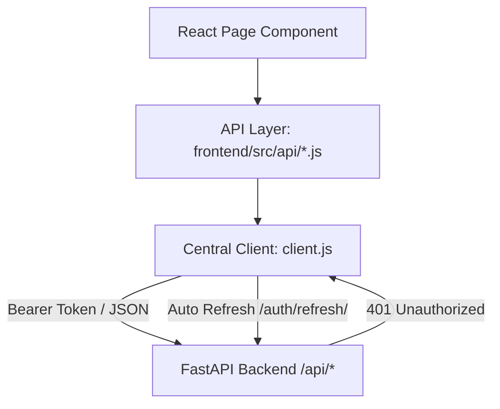

# CodeFoundry — CF-034A: Frontend UI Audit & Redesign Preparation Report

**Date**: 2026-10-23  
**Auditor**: Antigravity AI  
**Scope**: CodeFoundry React/Vite Frontend Architecture, Styling, Component Inventory, and Redesign Readiness  
**Status**: Completed — Ready for Visual Direction Approval  

---

## 1. Executive Summary

This audit assesses the current state of the CodeFoundry frontend (`frontend/`), cataloging all 11 pages, 8 shared/motion components, 9 API client modules, and the global CSS architecture. 

The application is built on **React 18 + Vite**, using **Vanilla CSS** with a design system defined in `frontend/src/styles/global.css` and `@monaco-editor/react` for its code workspace. The platform already implements complete user authentication, challenge exploration, incident diagnostic simulations, a multi-file Monaco code editor, real-time Docker sandbox execution polling, deterministic skill profiling, a global leaderboard, public profiles, and a recruiter talent hub.

**Crucial Redesign Finding**: All backend communication is strictly decoupled via `frontend/src/api/*.js`, and page state flows through clean React state hooks. Therefore, a complete visual and UX redesign can be executed safely without risking regressions to backend endpoints, Celery evaluation queuing, Docker sandboxing, or authentication mechanics—provided existing state signatures and form triggers are preserved.

---

## 2. Existing Frontend Architecture

### 2.1 Technology Stack & Dependencies
From `frontend/package.json`:
- **Core Runtime**: React `18.3.1`, React DOM `18.3.1`
- **Routing**: `react-router-dom` `^6.26.2` (BrowserRouter in `src/main.jsx`, declarative `<Routes>` in `src/App.jsx`)
- **Code Editor**: `@monaco-editor/react` `^4.7.0` (Monaco engine with web-worker integration)
- **Build Tooling**: Vite `5.4.3` with `@vitejs/plugin-react` `^4.3.1`
- **External UI Frameworks**: **None** (No Tailwind, Bootstrap, Material-UI, or Chakra). All styles are pure CSS.

### 2.2 Directory Structure
```text
frontend/
├── index.html                   # HTML entry point, Google Fonts preconnect (Inter, JetBrains Mono)
├── package.json                 # Dependency definitions
├── vite.config.js               # Vite bundler configuration
├── public/
│   ├── fonts/                   # 44 local woff2 fonts (including General Sans variants)
│   └── images/                  # 145 SVGs and PNG asset exports
└── src/
    ├── main.jsx                 # React root renderer, BrowserRouter mount, global.css import
    ├── App.jsx                  # Root layout, AuthProvider, BackgroundCanvas, Navbar, Routes
    ├── api/                     # Decoupled backend HTTP service layer
    │   ├── client.js            # Fetch wrapper with Bearer token & automatic 401 token refresh queue
    │   ├── auth.js              # Register, login, refresh, me, logout endpoints
    │   ├── challenges.js        # Catalog search, filter, details, user progress summary
    │   ├── dashboard.js         # Student overview metrics & aggregated skill profile
    │   ├── execution.js         # Interactive code test execution (/execution/run/)
    │   ├── leaderboard.js       # Global ranked developer standings
    │   ├── profile.js           # Public developer profile by username
    │   ├── recruiter.js         # Candidate talent search, detailed assessment, candidate evidence
    │   └── submissions.js       # Submit code, poll submission status, submission history
    ├── context/
    │   └── AuthContext.jsx      # React context: token storage, user object, login, register, logout
    ├── components/
    │   ├── Navbar.jsx           # Global sticky navbar, role-aware navigation, auth pill
    │   ├── ProtectedRoute.jsx   # Route guard redirecting unauthenticated users to /login
    │   ├── CodeEditor.jsx       # Monaco editor wrapper with language normalization & vs-dark theme
    │   ├── RepositoryTree.jsx   # Collapsible file-tree for multi-file repositories
    │   ├── Loading.jsx          # Simple spinner and message display
    │   └── motion/
    │       ├── AnimatedCounter.jsx   # requestAnimationFrame smooth counter with prefers-reduced-motion
    │       ├── AnimatedProgress.jsx  # Staggered animated percentage bar
    │       └── BackgroundCanvas.jsx  # Fixed background ambient grid and radial glow orbs
    ├── pages/                   # 11 distinct application views
    │   ├── Home.jsx             # Marketing landing page with hero, workflow, & interactive preview
    │   ├── Login.jsx            # Sign-in form with return navigation state
    │   ├── Register.jsx         # Sign-up form with password confirmation
    │   ├── Dashboard.jsx        # Student metrics overview & 6-dimensional skill profile
    │   ├── Challenges.jsx       # Searchable & filterable challenge library
    │   ├── ChallengeDetails.jsx # Incident simulation briefing & challenge entrypoint
    │   ├── Workspace.jsx        # Monaco IDE, file tree, test runner, async submit & results panel
    │   ├── SubmissionHistory.jsx# Paginated submission archives with status filtering
    │   ├── Leaderboard.jsx      # Global rankings with top-3 podium
    │   ├── PublicProfile.jsx    # Developer showcase with badges & verified competency metrics
    │   └── RecruiterDashboard.jsx# Recruiter candidate filter, candidate drawer, & candidate comparison
    └── styles/
        └── global.css           # Monolithic 1,205-line CSS design system
```

---

## 3. Styling & Theme Architecture

### 3.1 Styling Method
All styling is currently handled through:
1. `src/styles/global.css`: Monolithic style sheet containing CSS custom properties, utility classes, buttons, cards, tables, badges, and keyframes.
2. **Inline React Styles (`style={{ ... }}`)**: A very high percentage of layout, spacing, colors, and typography across page components is declared inline.

### 3.2 Design Tokens & CSS Variables (`:root`)
Defined in `src/styles/global.css` (lines 20–122):
- **Surfaces**: Clean Light SaaS palette (`--bg-primary: #ffffff`, `--bg-secondary: #f8fafc`, `--bg-tertiary: #f1f5f9`, `--bg-card: #ffffff`, `--bg-elevated: #ffffff`, `--bg-glass: rgba(255, 255, 255, 0.85)`).
- **Brand Accents**: Indigo (`--accent-primary: #6366f1`), Purple (`#8b5cf6`), Blue (`#2563eb`), Cyan (`#06b6d4`), Emerald (`#10b981`), Amber (`#f59e0b`), Rose (`#ef4444`).
- **Borders & Shadows**: Subtle borders (`--border-color: #e2e8f0`, `--border-focus: #6366f1`) and multi-layer drop shadows (`--shadow-sm` through `--shadow-xl`).
- **Typography**:
  - Display: `'General Sans', 'Inter', -apple-system, sans-serif`
  - Sans-Serif: `'Inter', -apple-system, BlinkMacSystemFont, "Segoe UI", Roboto, sans-serif`
  - Monospace: `'JetBrains Mono', ui-monospace, SFMono-Regular, Menlo, Monaco, Consolas, monospace`
- **Badges**: Dedicated color tokens for challenge categories (`BUG_FIX`, `API`, `SECURITY`, `PERFORMANCE`, `DATABASE`, `TESTING`) and difficulty ratings (`BEGINNER`, `INTERMEDIATE`, `ADVANCED`, `EXPERT`).

### 3.3 Theme & Dark Mode Status
- **Current State**: The overall application is locked to a **Light Mode SaaS** theme (`#ffffff` surfaces with slate text `#0f172a`).
- **Theme Inconsistency**:
  - `CodeEditor.jsx` defaults to `vs-dark` (dark theme Monaco).
  - Diagnostic simulation in `ChallengeDetails.jsx` uses dark background (`#0f172a` / `#1e293b`).
  - Terminal log output in `Workspace.jsx` uses a dark terminal background.
  - The rest of the interface is stark white. There is currently **no dark/light mode toggle** or automatic `prefers-color-scheme` CSS implementation.

---

## 4. Page and Component Inventory

| Page Name | Route Path | Access Level | Primary Component File | API Integration | Key Features Verified |
| :--- | :--- | :--- | :--- | :--- | :--- |
| **Landing Page** | `/` | Public | `src/pages/Home.jsx` | `useAuth()` | Hero section, interactive demo card, step-by-step workflow, tech stack badges, CTA buttons. |
| **Login** | `/login` | Public | `src/pages/Login.jsx` | `loginUser` (`/auth/login/`) | Form validation, redirect to intended target via `location.state.from`, error alerts. |
| **Register** | `/register` | Public | `src/pages/Register.jsx` | `registerUser` (`/auth/register/`) | Username, email, password confirmation, validation, redirect to login with success message. |
| **Dashboard** | `/dashboard` | Protected | `src/pages/Dashboard.jsx` | `getDashboard`, `getSkillProfile` | 4 metric tiles (attempted, passed, submissions, overall score), 6-dimension skill bars, recent activity table, brand-new user empty state. |
| **Challenge Catalog** | `/challenges` | Protected | `src/pages/Challenges.jsx` | `getChallenges`, `getChallengeProgress` | Search filter, difficulty dropdown, category dropdown, clear filters, pagination, solved badges. |
| **Challenge Details** | `/challenges/:id` | Protected | `src/pages/ChallengeDetails.jsx` | `getChallenge`, `getChallengeSubmissions` | Gamified incident simulator ("SOMETHING IS BROKEN"), diagnostic telemetry animation, problem description, starter files preview, previous attempts list, "Enter Workspace" CTA. |
| **Code Workspace** | `/workspace/:id` | Protected | `src/pages/Workspace.jsx` | `getChallenge`, `runCode`, `createSubmission`, `getSubmission` | Multi-file repository tree, file content switching, read-only file badges, Monaco editor, stdin input, "Run Tests" (instant backend execution), "Submit Solution" (async Celery/Docker submission with polling), execution logs, skill score breakdown. Session storage recovery for ongoing evaluations. |
| **Submission Archives** | `/submissions` | Protected | `src/pages/SubmissionHistory.jsx` | `getSubmissions` | Status filtering (All, Passed, Failed, Pending, Error), pagination, test suite breakdown expander. |
| **Global Leaderboard** | `/leaderboard` | Protected | `src/pages/Leaderboard.jsx` | `getLeaderboard` | Top 3 podium display (Gold, Silver, Bronze), ranked global developer table, links to public profiles. |
| **Public Profile** | `/profile/:username` | Public | `src/pages/PublicProfile.jsx` | `getPublicProfile` | Verified engineering profile, overall score, badges earned (e.g. Bug Slayer, Security Hunter), 6-dimension competency bars, solved challenges list, 404 not-found state. |
| **Recruiter Hub** | `/recruiter`, `/recruiter/compare` | Protected (Role-Restricted) | `src/pages/RecruiterDashboard.jsx` | `getRecruiterCandidates`, `getRecruiterCandidate` | Candidate candidate list, min-skill filter, challenge type filter, slide-out assessment drawer, candidate comparison modal with multi-dimensional radar comparison, 403 forbidden state. |

---

## 5. Shared Component Inventory

| Component | Path | Purpose & Dependencies |
| :--- | :--- | :--- |
| **Navbar** | `src/components/Navbar.jsx` | Top persistent navigation bar. Detects scroll for background blur. Renders role-aware links (e.g., "Recruiter Hub" only visible if `role === 'RECRUITER'` or `is_staff`). Mobile hamburger drawer toggle. |
| **ProtectedRoute** | `src/components/ProtectedRoute.jsx` | Guards authenticated routes. Renders `<Loading>` during token check; redirects unauthenticated visitors to `/login` preserving intended destination. |
| **CodeEditor** | `src/components/CodeEditor.jsx` | Monaco code editor wrapper (`@monaco-editor/react`). Normalizes file extensions to Monaco language IDs (`.py` -> `python`, `.json` -> `json`, etc.). Read-only mode support. Configures JetBrains Mono font, smooth scrolling, and minimap. |
| **RepositoryTree** | `src/components/RepositoryTree.jsx` | Transforms flat file lists into a hierarchical tree. Handles directory expansion/collapse, file selection, read-only locks (`🔒`), and test file indicators. |
| **Loading** | `src/components/Loading.jsx` | Reusable spinner and message box (`.loading-box`, `.spinner`). |
| **AnimatedCounter** | `src/components/motion/AnimatedCounter.jsx` | Numerical tweening component using `requestAnimationFrame` with ease-out quad curve. Honors `prefers-reduced-motion`. |
| **AnimatedProgress** | `src/components/motion/AnimatedProgress.jsx` | Staggered animated percentage bar with cubic-bezier easing. |
| **BackgroundCanvas** | `src/components/motion/BackgroundCanvas.jsx` | Ambient background glow orbs and subtle grid overlay (`.ambient-background-system`). |

---

## 6. Page-to-File Styling Mapping

The following table maps which style selectors and files directly govern each page view:

| View / Page | Primary Stylesheet Selectors in `global.css` | Inline Styles Preponderance |
| :--- | :--- | :--- |
| **Global Shell** | `.app-container`, `.main-content`, `.ambient-background-system` | Minimal |
| **Navbar** | `.navbar`, `.navbar-scrolled`, `.navbar-brand`, `.navbar-nav`, `.nav-link`, `.mobile-nav-toggle`, `.user-pill` | Moderate (pills, brand fonts) |
| **Home** | `.hero-title`, `.hero-subtitle`, `.accent-gradient`, `.gency-hero-badge`, `.btn-saas`, `.btn-saas-primary`, `.btn-saas-secondary`, `.code-mockup-window` | High (grid column spacing, CTA gaps) |
| **Login / Register** | `.card`, `.form-group`, `.form-label`, `.input-control`, `.btn-saas-primary`, `.animate-fade-in-up`, `.animate-scale-in` | High (centering flex, box shadows) |
| **Dashboard** | `.page-container`, `.page-title`, `.page-description`, `.gency-stats-grid`, `.gency-stat-tile`, `.gency-stat-number`, `.gency-stat-label`, `.skill-card`, `.skill-card-top`, `.skill-name`, `.skill-score`, `.table-container` | Very High (cards, gradients, stat tiles) |
| **Challenges** | `.filter-bar`, `.search-input`, `.filter-select`, `.challenge-card`, `.challenge-title`, `.badge-BEGINNER`, `.badge-BUG_FIX`, `.status-pill`, `.pagination` | High (card metadata grids, active pills) |
| **ChallengeDetails** | `.badge`, `.status-pill`, `.incident-alert-banner`, `.diagnostic-terminal`, `.btn-saas-primary`, `.tab-nav` | Extremely High (trajectories, diagnostic steps) |
| **Workspace** | `.workspace-container`, `.workspace-header`, `.workspace-pane`, `.editor-tab-bar`, `.result-panel`, `.terminal-output`, `.metric-chip` | Extremely High (grid definitions, panel splits) |
| **SubmissionHistory**| `.table-container`, `table`, `thead`, `tbody`, `.badge-passed`, `.badge-failed`, `.badge-pending`, `.pagination` | High (filter containers, expanded test logs) |
| **Leaderboard** | `.podium-container`, `.podium-card`, `.podium-rank`, `.table-container`, `.user-avatar-pill` | High (podium heights, trophy colors) |
| **PublicProfile** | `.profile-header`, `.user-avatar-large`, `.badge-tile`, `.skill-grid`, `.timeline-card` | High (badge chips, verified checkmarks) |
| **RecruiterDashboard**| `.recruiter-grid`, `.candidate-row`, `.drawer-backdrop`, `.drawer-panel`, `.comparison-modal`, `.metric-bar` | Extremely High (drawer positioning, table rows) |

---

## 7. Responsive Design & Usability Findings

1. **Workspace Multi-Column Layout**:
   - `Workspace.jsx` uses a fixed desktop grid: `gridTemplateColumns: '320px 1fr'`.
   - On screens `< 900px`, the 320px left sidebar (Mission briefing + File tree + Stdin) creates severe horizontal crowding or overflows with no collapsible drawer mechanism.
2. **Navbar Mobile Menu**:
   - `Navbar.jsx` includes a functional hamburger menu toggle (`.mobile-nav-toggle`, `aria-expanded`). On screens `< 768px`, the nav links stack vertically via `.mobile-open`.
3. **Card Grids**:
   - `Dashboard.jsx`, `Challenges.jsx`, and `Leaderboard.jsx` employ responsive CSS grids with `repeat(auto-fit, minmax(280px, 1fr))`, adapting gracefully between 1, 2, 3, and 4 columns.
4. **Tables on Narrow Screens**:
   - Tables in `Dashboard.jsx`, `SubmissionHistory.jsx`, `Leaderboard.jsx`, and `RecruiterDashboard.jsx` are wrapped in `.table-container` with `overflow-x: auto`, preventing page-wide layout breakage on mobile.
5. **Incident Simulation Trajectories in ChallengeDetails**:
   - The burst trajectories (`BURST_TRAJECTORIES`) use fixed pixel translations (`dx: '-240px'`, `dx: '275px'`). On mobile screens (< 480px), these elements can momentarily trigger horizontal overflow during the reveal animation.

---

## 8. Accessibility (a11y) Findings

1. **Form Labels & Inputs**:
   - All text inputs on `Login.jsx`, `Register.jsx`, `Challenges.jsx`, and `Workspace.jsx` have explicit `<label>` tags with matching `htmlFor` and `id` attributes.
2. **Motion Sensitivity**:
   - `AnimatedCounter.jsx` checks `window.matchMedia('(prefers-reduced-motion: reduce)')` and immediately renders final numeric values without animation if preferred by the user.
3. **Color Contrast**:
   - Primary text (`#0f172a`) against white (`#ffffff`) or light slate (`#f8fafc`) yields an excellent WCAG AAA contrast ratio (> 12:1).
   - Some secondary badge colors (e.g. `--badge-testing-bg: #ecfeff` with cyan text `#0891b2`) and muted text (`#94a3b8`) on white have border-line contrast (~2.8:1 to 3.5:1) and should be darkened for WCAG AA compliance.
4. **Modal Dialogs**:
   - The Candidate Comparison Modal in `RecruiterDashboard.jsx` does not currently trap keyboard focus or declare `aria-modal="true"`.
5. **Non-Text Content**:
   - Emoji icons (e.g. `🐛`, `⚡`, `🛡️`) are rendered inline without `aria-hidden="true"` or `role="img"` with labels in some component files.

---

## 9. Existing UI Issues (Cataloged for Redesign)

1. **Excessive Inline Style Fragmentation**:
   - Hundreds of lines across `Workspace.jsx`, `ChallengeDetails.jsx`, and `RecruiterDashboard.jsx` define padding, borders, colors, and shadows directly in JSX `style={{ ... }}` rather than using centralized design tokens. This makes global theme adjustments (like dark mode or spacing adjustments) tedious and inconsistent.
2. **Visual Disconnect Between Monaco Editor & Page Theme**:
   - The workspace surrounds a `vs-dark` Monaco editor with white and light-gray panels (`#f8fafc`, `#e2e8f0`). A unified dark mode or a properly framed dark IDE workbench will significantly elevate the developer experience.
3. **Fixed Editor Height & Panel Sizing**:
   - In `Workspace.jsx`, the editor height and bottom output panel are in a static vertical flexbox without a draggable splitter, making it difficult for developers to expand the test output panel when debugging verbose stack traces.
4. **Cluttered Incident Animation in ChallengeDetails**:
   - While the incident simulation in `ChallengeDetails.jsx` is creative, the animation sequence creates visual turbulence before allowing the user to read the challenge briefing. Adding a persistent "Skip Animation" preference or streamlining the briefing header will improve user velocity.
5. **Asset Bloat in Public Directory**:
   - `frontend/public/fonts` contains 44 `.woff2` files and `frontend/public/images` contains 145 SVG/PNG files exported from an earlier landing page template that are no longer referenced in source code.

---

## 10. Frontend API Connections & Integration Safety

All page components communicate through standardized API functions in `frontend/src/api/`:



### Safety Guarantees for the Redesign:
- **No API Changes Required**: The JSON request and response payloads are fully decoupled from how the UI renders them.
- **State Signatures to Preserve**:
  - `Workspace.jsx`: `handleRunCode` (dispatches to `runCode`) and `handleSubmitSolution` (dispatches to `createSubmission` and calls `startPolling`).
  - `Challenges.jsx`: Query parameters `{ search, difficulty, challenge_type, page, page_size }`.
  - `Dashboard.jsx`: Reads `overview` and `recent_submissions` from `getDashboard()`, plus `skills` from `getSkillProfile()`.
  - `RecruiterDashboard.jsx`: Reads `results` from `getRecruiterCandidates()`.

---

## 11. Recommended Redesign Sequence

To ensure zero downtime and prevent functional regressions, execute the UI redesign in the following systematic phases:

1. **Phase 1: Design System & Token Foundation**
   - Refactor `src/styles/global.css` with a cohesive, polished token system (surfaces, typography, elevation, glassmorphism, border glows).
   - Establish consistent utility classes (`.btn-primary`, `.btn-secondary`, `.card-panel`, `.badge-chip`, `.table-view`) to eliminate ad-hoc inline styles.
   - Introduce clean Dark Mode support (via CSS custom properties and a data-theme attribute on `<html>`).

2. **Phase 2: Core Shared Components**
   - Modernize `Navbar.jsx` with sleek glassmorphism, responsive mobile drawer, and active tab indicators.
   - Refine `Loading.jsx` with an engineering-themed skeleton/pulse loader.
   - Polish `RepositoryTree.jsx` with crisp file icons and active state highlights.
   - Refine `CodeEditor.jsx` to synchronize seamlessly with the platform theme.

3. **Phase 3: Public & Authentication Pages**
   - Redesign `Home.jsx` into a high-converting, modern developer platform landing page.
   - Elevate `Login.jsx` and `Register.jsx` with sleek, centered card styling, floating input labels, and clear validation feedback.
   - Polish `PublicProfile.jsx` into a verified developer portfolio showcase.

4. **Phase 4: Challenge Exploration & Briefing**
   - Redesign `Challenges.jsx` catalog with modern search pills, filter chips, difficulty badges, and responsive challenge cards.
   - Streamline `ChallengeDetails.jsx` incident simulator into an elegant, high-impact mission briefing with clear tabs for instructions, files, and past runs.

5. **Phase 5: The Flagship Engineering Workspace (`Workspace.jsx`)**
   - Overhaul `Workspace.jsx` into a premier engineering IDE:
     - Sleek dark theme workbench matching Monaco `vs-dark`.
     - Mobile/tablet friendly collapsible sidebar drawer for the repository tree and mission briefing.
     - Redesigned test results tab showing passed/failed assertions, runtime benchmarks, stdout/stderr, and multi-dimensional skill breakdown cards.

6. **Phase 6: Analytics, History & Recruiter Hub**
   - Refresh `Dashboard.jsx` with data visualization cards for the 6 engineering skill dimensions.
   - Polish `SubmissionHistory.jsx` and `Leaderboard.jsx` with clean tabular data formatting and podium awards.
   - Modernize `RecruiterDashboard.jsx` with talent comparison cards, evidence drill-downs, and accessible modals.

---

## 12. Files Likely to Require Modification in Subsequent Phases

### Core Style Files:
- [`frontend/src/styles/global.css`](file:///c:/Users/babun/Documents/codefoundry/frontend/src/styles/global.css)

### Shared Components:
- [`frontend/src/components/Navbar.jsx`](file:///c:/Users/babun/Documents/codefoundry/frontend/src/components/Navbar.jsx)
- [`frontend/src/components/RepositoryTree.jsx`](file:///c:/Users/babun/Documents/codefoundry/frontend/src/components/RepositoryTree.jsx)
- [`frontend/src/components/CodeEditor.jsx`](file:///c:/Users/babun/Documents/codefoundry/frontend/src/components/CodeEditor.jsx)
- [`frontend/src/components/Loading.jsx`](file:///c:/Users/babun/Documents/codefoundry/frontend/src/components/Loading.jsx)

### Pages:
- [`frontend/src/pages/Home.jsx`](file:///c:/Users/babun/Documents/codefoundry/frontend/src/pages/Home.jsx)
- [`frontend/src/pages/Login.jsx`](file:///c:/Users/babun/Documents/codefoundry/frontend/src/pages/Login.jsx)
- [`frontend/src/pages/Register.jsx`](file:///c:/Users/babun/Documents/codefoundry/frontend/src/pages/Register.jsx)
- [`frontend/src/pages/Dashboard.jsx`](file:///c:/Users/babun/Documents/codefoundry/frontend/src/pages/Dashboard.jsx)
- [`frontend/src/pages/Challenges.jsx`](file:///c:/Users/babun/Documents/codefoundry/frontend/src/pages/Challenges.jsx)
- [`frontend/src/pages/ChallengeDetails.jsx`](file:///c:/Users/babun/Documents/codefoundry/frontend/src/pages/ChallengeDetails.jsx)
- [`frontend/src/pages/Workspace.jsx`](file:///c:/Users/babun/Documents/codefoundry/frontend/src/pages/Workspace.jsx)
- [`frontend/src/pages/SubmissionHistory.jsx`](file:///c:/Users/babun/Documents/codefoundry/frontend/src/pages/SubmissionHistory.jsx)
- [`frontend/src/pages/Leaderboard.jsx`](file:///c:/Users/babun/Documents/codefoundry/frontend/src/pages/Leaderboard.jsx)
- [`frontend/src/pages/PublicProfile.jsx`](file:///c:/Users/babun/Documents/codefoundry/frontend/src/pages/PublicProfile.jsx)
- [`frontend/src/pages/RecruiterDashboard.jsx`](file:///c:/Users/babun/Documents/codefoundry/frontend/src/pages/RecruiterDashboard.jsx)

---

## 13. Risks to Existing Functionality & Mitigation Strategies

| Risk | Impact | Mitigation Strategy |
| :--- | :--- | :--- |
| **Monaco Editor Re-render Flickering** | User loses cursor position or editor unmounts on tab switch. | Never wrap the Monaco container in CSS transforms, transitions, or scale animations. Keep editor value state stable. |
| **Breaking Polling & Submission State** | User submits code but results never render or polling hangs. | Preserve the exact polling state logic and `ACTIVE_SUBMISSION_STORAGE_KEY` session recovery in `Workspace.jsx`. |
| **API Parameter Misalignment** | Filters in Challenges, Submissions, or Recruiter Hub stop working. | Keep query parameter keys (`search`, `difficulty`, `challenge_type`, `min_skill_score`, `page`) unchanged. |
| **Role-Based Navigation Breakage** | Candidates see recruiter routes or recruiters lose access. | Retain `isRecruiterOrAdmin` condition (`user?.role === 'RECRUITER' \|\| user?.role === 'ADMIN' \|\| user?.is_staff`) in `Navbar.jsx`. |
| **Form Submission Default Behavior** | Form reloads page instead of running async auth. | Keep `e.preventDefault()` on all `<form onSubmit={...}>` handlers. |

---

## 14. Conclusion & Next Steps

The CodeFoundry frontend architecture is solid, modular, and ready for a modern UI redesign. All functional capabilities—from authentication to code execution and skill scoring—are verified and cleanly separated from the visual presentation layer.

**Awaiting user approval and visual reference direction before proceeding with code modifications.**
